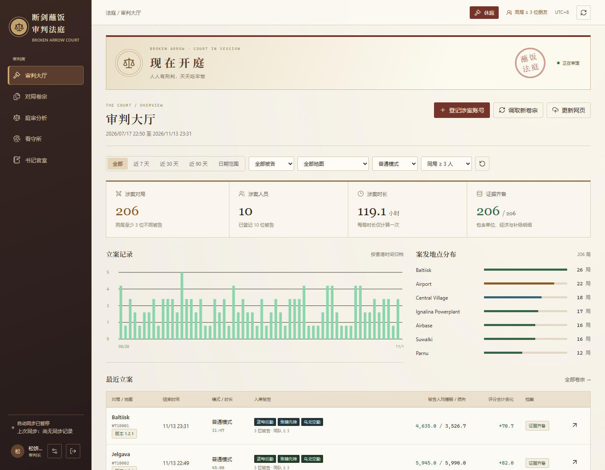
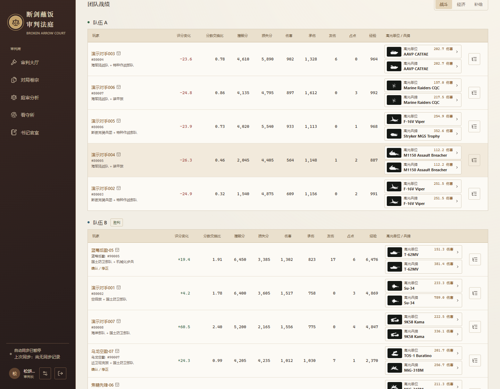
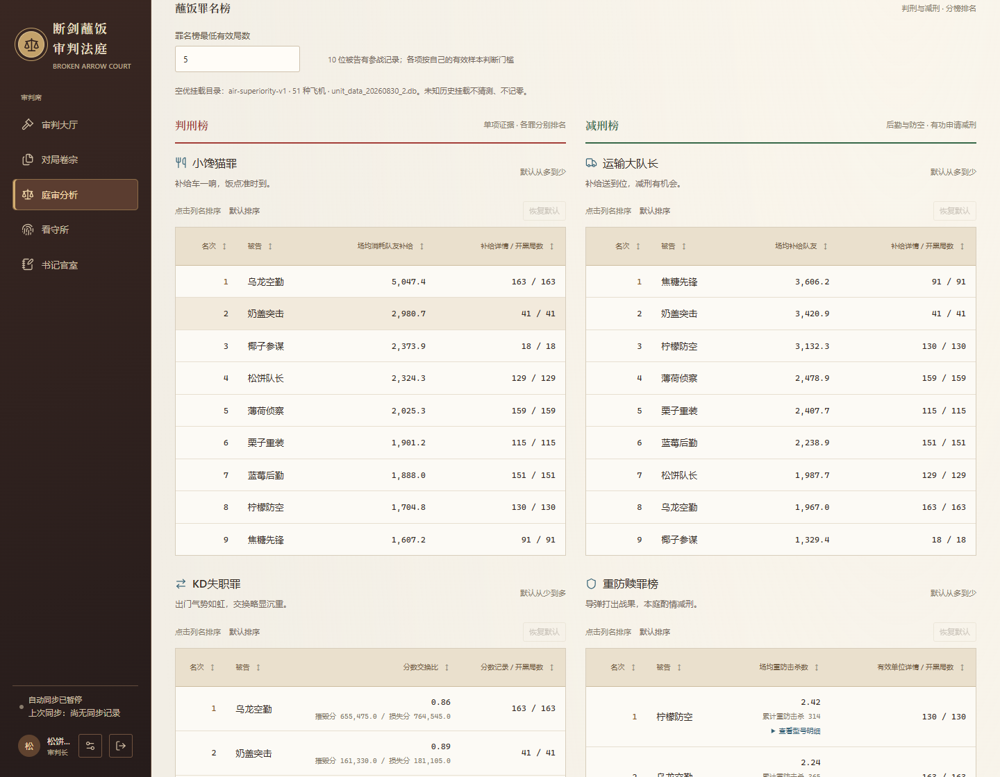
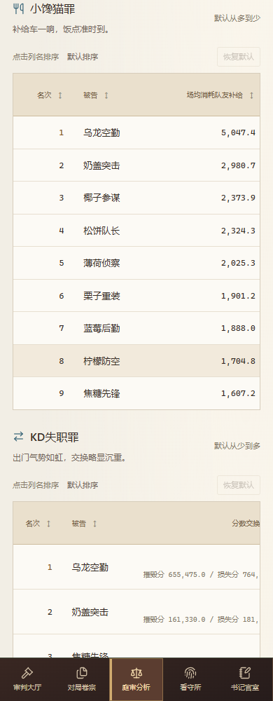

<div align="center">

# 断剑蘸饭审判法庭

**打完别急着散，先来开个庭。**

给 Broken Arrow 固定开黑队的一本战绩账：归档对局、对比队友、追查补给。<br>把有据可查的赛后争论，变成朋友间的快乐庭审。

[](https://github.com/sisi4376/broken-arrow-court/releases/latest)  

### [↓ 下载 Windows 一键部署程序](https://github.com/sisi4376/broken-arrow-court/releases/latest/download/BrokenArrowCourt.exe)

[发布说明与校验文件](https://github.com/sisi4376/broken-arrow-court/releases/latest) · [快速上手](#quick-start) · [完整使用手册](https://github.com/sisi4376/broken-arrow-court/blob/master/docs/USER_GUIDE.md) · [反馈问题](https://github.com/sisi4376/broken-arrow-court/issues)

</div>



<p align="center"><sub>真实程序界面 · 截图使用虚构测试账号与样例对局 · 开庭模式可随时切换</sub></p>

## 这局到底谁在蘸饭？

“我一直在给你送补给。”“这局分低是因为我在打防空。”“别只看胜率，看看我跟谁排的。”

如果你们的小队也有这些赛后经典台词，这个项目就是为你们准备的。把散落的对局记录整理成同一份档案：既能看长期表现，也能点进具体一局，翻到玩家、单位和装备明细。

| 赛后想问的事 | 在这里能看到什么 |
| --- | --- |
| **谁把队友的补给吃空了？** | 补给消耗、从队友获取与向队友供给分开展示；“小馋猫罪”和“运输大队长”各有榜单。 |
| **谁是真正的防空功臣？** | 重防与实际纯空优挂载战果，带单位或挂载依据；缺少证据的对局保留未知。 |
| **谁和谁一起排更顺？** | 同队搭档、专精组合与地图表现，按日期、成员、模式和开黑人数筛选。 |
| **这张兵牌到底值多少钱？** | 单位、装备挂载与参考价格明细，结合对局版本区分历史价格。 |
| **换了小号，历史怎么算？** | 一位朋友可绑定多个游戏账号，合并统计；同一个人不会被重复算成两位队友。 |
| **谁该“判”，谁能“减刑”？** | 娱乐刑期榜展示当前规则的结果与分项，个人页与榜单使用同一口径。 |

> 刑期、罪名和蘸饭指数都是朋友之间的自定义娱乐规则，不是官方实力评级。数值用于复盘和整活，不能替代对战术分工与实际回放的判断。

## 从战绩面板，到你们自己的法庭

### 有榜单，也有能翻的卷宗

总览看队伍，个人页看长期表现，单场详情看具体证据。战斗、经济、补给各有视角；摧毁分与损失分、单位击杀与损耗分别呈现。缺失详情会标出样本范围，避免把“没记录”当成“没贡献”。



### 开庭之后，连界面都有了仪式感

深木色侧栏、旧纸色卷宗、酒红印章。总览变成“审判大厅”，朋友名单变成“看守所”，数据管理变成“书记官室”。点击 **开庭 / 休庭** 即可切换；主题改变称呼和视觉，保留同一份数据与统计规则。

<table>
<tr>
<td width="74%"></td>
<td width="26%"></td>
</tr>
<tr>
<td align="center"><sub>桌面端：判刑榜与减刑榜并排查看</sub></td>
<td align="center"><sub>手机端：随手翻案</sub></td>
</tr>
</table>

### 一个人维护，全队都能看

Windows 桌面管理器负责后台启停、同步、发布和状态检查。把只读网页发布到 GitHub Pages，也可使用 Cloudflare Pages 或 EdgeOne Pages 托管；朋友打开链接就能查看，无需安装程序或登录管理后台。

采集后台在你的电脑上运行，原始数据库保存在本机。公开网页使用单独导出的快照，电脑关机后，已发布的内容仍可访问。

<a id="quick-start"></a>

## 下载后，先跑起第一场庭审

**推荐环境：Windows 10 / 11 x64。** EXE 内置 Node.js 24 运行时，本机使用无需另装 Node.js 或执行 `npm install`。

1. **下载并启动。** 从 [最新版发布页](https://github.com/sisi4376/broken-arrow-court/releases/latest) 下载 `BrokenArrowCourt.exe`，放在一个固定目录，双击运行。旁边没有完整项目时，程序默认释放到用户的本地应用目录，也可在管理器中选择新的空目录。
2. **创建你的管理员。** 在桌面管理器启动后台，打开本机管理页；首次访问创建管理员，没有预置密码。默认地址为 `http://127.0.0.1:4317`，实际地址以管理器显示为准。
3. **登记开黑队。** 添加朋友，绑定游戏账号；每人可以有多个号。默认统计“同局至少 3 位不同朋友”，需要时可切换“同队 ≥ 3 人”或“所有比赛”。
4. **同步，然后开庭。** 在数据管理中启动同步，等待已有对局逐步归档，再查看总览、个人页和卷宗。想要法庭主题，点击右上角 **开庭**。

首次回溯受上游数据完整度和限速影响，可能需要等待。自动更新需要保持本机后台运行。

<details>
<summary><strong>想把法庭链接发到群里？</strong></summary>

1. 安装 [Git](https://git-scm.com/downloads) 与 [GitHub CLI](https://cli.github.com/)，登录自己的 GitHub 账号。
2. 在桌面管理器的 **网页发布** 中填写一个独立的发布仓库，例如 `你的用户名/your-court-pages`。这个仓库存放生成的网站文件。
3. 首次部署确认要公开的数据，点击 **一键部署 Pages**，等待 GitHub 完成构建。
4. 将生成的网站链接发给队友。以后可点击 **立即更新网页**；后台也会在采集和公开数据变化后检查发布。

详细配置见 [GitHub Pages 一键部署](https://github.com/sisi4376/broken-arrow-court/blob/master/docs/USER_GUIDE.md#github-deploy)。Cloudflare 与 EdgeOne 的首次账号授权和托管设置需要另行完成，见完整手册。

</details>

<details>
<summary><strong>已经有旧项目或历史数据？</strong></summary>

先备份原项目的配置和数据库。新版 EXE 可以放回已有完整项目的根目录，使用原目录的程序、配置与数据；它不会自动覆盖本地源码。需要更新已有项目时，请同时更新源码并重启后台，详见 [更新功能或样式](https://github.com/sisi4376/broken-arrow-court/blob/master/docs/USER_GUIDE.md#更新功能或样式)。

只把 EXE 移到另一台电脑，不会迁移历史数据、朋友名单或 GitHub 登录。恢复步骤见 [导入、导出与备份](https://github.com/sisi4376/broken-arrow-court/blob/master/docs/USER_GUIDE.md#导入导出与备份)。

</details>

## 你需要知道的几件事

- **本机能用，公开发布可选。** 不发布网页也能在本机管理和分析；持续采集需要电脑上的后台运行。Pages 承载已发布的只读快照。
- **只读页面里的内容仍然是公开数据。** 发布会包含选定范围内的朋友称呼、游戏账号、对局和单位明细；登录凭据、原始数据库、配置与备份不随网页导出。首次公开前请与朋友确认。
- **统计依赖上游记录。** 当前支持 BATrace 与官方数据源；覆盖范围、历史深度和详情完整度受上游影响，不能保证所有对局都能取回。
- **联网服务有可用性限制。** 首次登录、同步与发布需要联网；国内访问 GitHub Pages 等托管服务的情况因网络而异。
- **下载请认准本仓库。** EXE 尚未购买代码签名证书；发布页提供 SHA-256 校验文件。若系统拦截，请保留报错排查，不要关闭安全软件。

## 继续探索

| 想继续做什么 | 从这里开始 |
| --- | --- |
| 了解完整安装、部署与日常操作 | [使用与部署手册](https://github.com/sisi4376/broken-arrow-court/blob/master/docs/USER_GUIDE.md) |
| 让群友在网页请求更新 | [可选的网页更新请求](https://github.com/sisi4376/broken-arrow-court/blob/master/docs/USER_GUIDE.md#群友在公开网页请求更新可选) |
| 理解默认开黑筛选与统计口径 | [开黑口径](https://github.com/sisi4376/broken-arrow-court/blob/master/docs/USER_GUIDE.md#开黑口径) |
| 查看娱乐刑期的规则和历史沿革 | [蘸饭指数与娱乐刑期](https://github.com/sisi4376/broken-arrow-court/blob/master/docs/USER_GUIDE.md#蘸饭指数与娱乐刑期) |
| 配置数据库备份或迁移电脑 | [导入、导出与备份](https://github.com/sisi4376/broken-arrow-court/blob/master/docs/USER_GUIDE.md#导入导出与备份) |
| 提交问题或功能建议 | [GitHub Issues](https://github.com/sisi4376/broken-arrow-court/issues) |

<details>
<summary><strong>开发者：从源码启动与验证</strong></summary>

需要 Node.js 24+。下载或克隆完整源码后，在项目根目录运行：

```sh
node --env-file-if-exists=.env src/server.mjs
```

本机程序无需安装 npm 依赖。默认本机地址为 `http://127.0.0.1:4317`；Windows 也可通过 `Start.ps1` 启动。

```sh
# 自动化测试
node --test --test-concurrency=1 test/*.test.mjs

# Windows 下构建自带运行时的桌面程序
powershell -NoProfile -ExecutionPolicy Bypass -File scripts/build-desktop.ps1
```

浏览器验证需要另备 Playwright 与 Chrome/Chromium。更多目录、配置与验证方式见 [开发与验证](https://github.com/sisi4376/broken-arrow-court/blob/master/docs/USER_GUIDE.md#开发与验证)。

</details>

---

**下次有人说“这把真不怪我”，把卷宗翻出来。**

[下载最新版，给你们的小队开个庭 →](https://github.com/sisi4376/broken-arrow-court/releases/latest)
